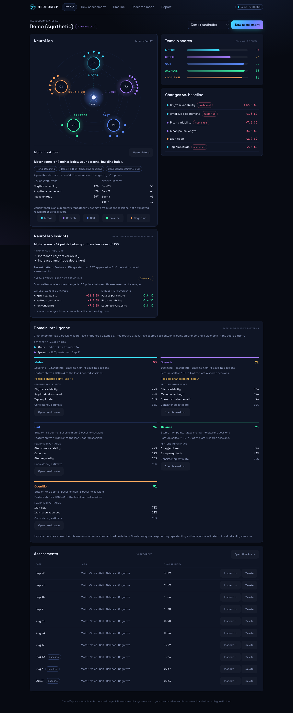
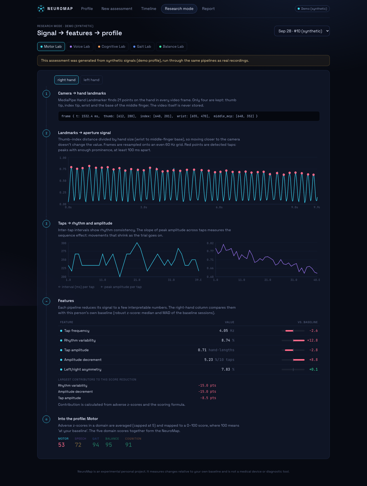
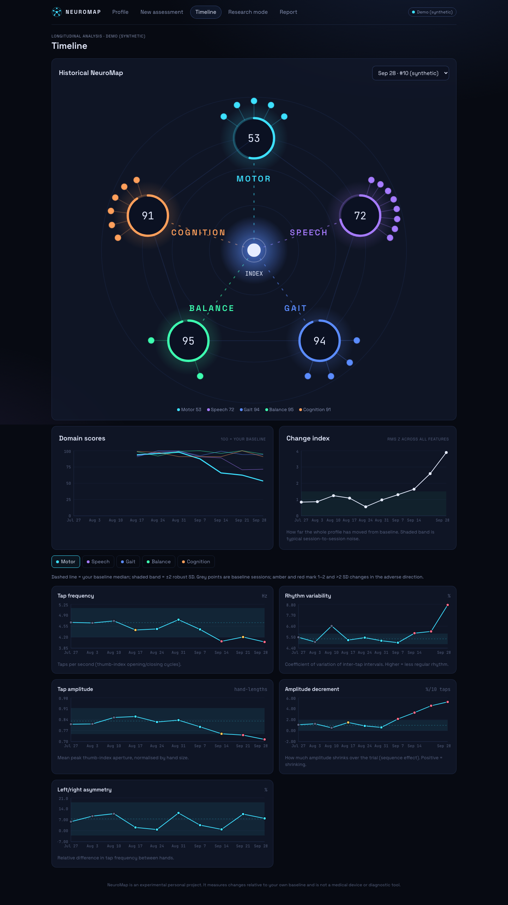

# NeuroMap

**Know your own normal.** A computational neuroscience lab that runs on a laptop and a phone.

**▶ Live demo: https://neuromap-86zk.onrender.com**  
**🎬 Demo video:** _add your YouTube link here_

Built by **Arjun Bhupatiraju** for the 2026 Congressional App Challenge (Texas District 31, TX-31).

People often notice neurological change too late, and routine checkups compare you to population averages instead of to your own normal. NeuroMap helps close that gap by turning movement, speech, gait, balance, and reaction-time signals into a personal baseline and longitudinal trend map.

NeuroMap records five kinds of behavioral signal, turns each into interpretable features, learns what is normal for *you*,
and tracks how your profile changes over time.

> NeuroMap measures change relative to your own baseline. It is a personal experiment, not a
> medical device, and it does not diagnose anything.

## Try it

1. Open the **[live demo](https://neuromap-86zk.onrender.com)**. It opens on a 10-week **Demo (synthetic)** profile
   with a built-in motor and speech decline, so you can explore the map, Timeline, Research mode and Report right away.
2. To run the labs yourself, type a name on the Profile page and click **Create profile**, then **New assessment**.
   - **Motor, Voice and Cognitive labs** run on a laptop (allow camera / microphone when asked).
   - **Gait and Balance labs** run on a phone: open the same link in Safari or Chrome and allow motion access.

The free hosting plan sleeps after 15 minutes without visitors, so the first load can take about a minute.
Assessments recorded on the live demo are temporary and may be reset; use a first name or nickname.

## Screenshots





## How it works

```
 CAMERA            MICROPHONE          SCREEN            PHONE IMU
 hand landmarks    16 kHz audio        RT + span         accel + gyro
      │                 │                  │                  │
 aperture signal   loudness / VAD      RT distribution    gravity removal
 tap detection     pitch tracking      span staircase     step / sway
      │                 │                  │                  │
      └──────── FEATURES (22, see backend/neuromap/registry.py) ─┘
                               │
                PERSONAL BASELINE (median / MAD of first sessions)
                               │
                    robust z-scores → domain scores (0–100)
                               │
          NEUROMAP · TIMELINE · RESEARCH MODE (every pipeline stage plotted)
```

## Running it locally

**Quickest (Python only):** the repo includes the built frontend in `frontend/dist`, so the backend can serve everything.

```bash
cd backend
pip install -r requirements.txt
uvicorn neuromap.api:app --port 8000      # open http://localhost:8000
```

**Development setup** (Python 3.10+ and Node 18+), with hot reload:

```bash
# 1. backend
cd backend
pip install -r requirements.txt
uvicorn neuromap.api:app --reload --port 8000

# 2. frontend (second terminal)
cd frontend
npm install
npm run dev            # http://localhost:5173
```

The downloadable project includes a preloaded **Demo (synthetic)** profile with a full 10-week
history, so a fresh install opens directly to the map. Click **Load synthetic demo profile** to
regenerate that clean demo; its raw signals are run through the real pipelines.

### On your phone (for the Gait and Balance labs)

Phones only allow camera, microphone and motion sensors over HTTPS, so:

```bash
cd frontend
npm run phone          # serves https://<your-laptop-LAN-ip>:5173 with a self-signed cert
```

Open that address on your phone (same Wi-Fi), accept the certificate warning, and use the same
profile name. On iPhone, Safari asks for motion permission when you tap Start.

### Single process (after building)

```bash
cd frontend && npm run build
cd ../backend && uvicorn neuromap.api:app --host 0.0.0.0 --port 8000
```

The backend serves the built frontend at `/`.

## The labs

| Lab | Input | Pipeline | Features |
|---|---|---|---|
| Motor | MediaPipe hand landmarks, 10 s per hand | thumb–index distance ÷ hand size → 60 Hz resample → peak detection | tap frequency, rhythm CV, amplitude, amplitude decrement, L/R asymmetry |
| Voice | Standard read-aloud passage, 16 kHz WAV | 25 ms frames → dB envelope → adaptive VAD → autocorrelation F0 | reading pace (81-word passage / duration), speech ratio, pauses/min, mean pause, F0 mean/variation/instability, loudness SD |
| Cognitive | 15 reaction trials + digit span | RT = t_response − t_stimulus, MAD outlier trim, span staircase | median RT, RT CV, lapses, false starts, max span, span accuracy |
| Gait | Phone IMU while walking 30 s | low-pass gravity estimate → project onto vertical → 0.5–3 Hz band-pass → step peaks, autocorrelation | cadence, step-time CV, intensity, regularity |
| Balance | Phone IMU standing still 20 s | gravity removal → horizontal component → 0.1–5 Hz | sway RMS, jerk RMS |

Only landmarks, features and small plot traces are stored. No video or audio is kept.

## Baseline and scoring (`backend/neuromap/baseline.py`)

- The first 6 sessions form the reference period. Scores appear after 3.
- Per feature: `z = (x − median) / (1.4826 · MAD)`, with the spread floored at 5% of the median.
- Each feature has a direction (`higher_is_worse` in the registry). A domain score is
  `100 − 15 × mean(adverse z, clipped to [0, 5])`.
- A feature is flagged past 2 SD, and marked **sustained** after 3 consecutive sessions past 1.5 SD.
- The change index is the RMS of all z-scores: ‖P(t) − P(baseline)‖.

## Dashboard intelligence

- Each NeuroMap node opens its domain score, recent trend, leading adverse feature shifts,
  baseline session count, consistency estimate, and recent score history. The same summary is
  available for all five domains below the map.
- Feature importance is the share of positive adverse z-scores for that domain in the latest
  assessment. It describes current baseline deviations; it is not a causal or model-based
  importance measure.
- Change points use a one-split comparison of domain-score levels. The dashboard requires at
  least five scored sessions, an 8-point level difference, and a 50% fit improvement before it
  flags a possible change. This is exploratory detection, not a statistical significance test.
- Baseline confidence reflects how many of the first six sessions contain measurements for that
  domain. The consistency percentage is an exploratory estimate from recent feature variation;
  it is not test-retest reliability or a clinically validated score.
- Correlation networks, digital-twin forecasts, assessment quality checks, tremor detection,
  gait symmetry, and balance coordination are not included yet.

## Project layout

```
backend/
  neuromap/
    registry.py      every feature: domain, label, unit, direction
    labs/            motor.py  voice.py  sensors.py  cognitive.py
    baseline.py      personal baseline, z-scores, domain scores
    synth.py         synthetic signal generators (tests + demo)
    demo.py          10-week demo profile with an injected motor/speech change
    store.py         SQLite
    api.py           FastAPI
    research/        experimental Parkinson's voice model (training, serving, results/)
  tests/             pipelines must recover known ground truth from synthetic signals
frontend/src/
  labs/              capture UIs (camera, mic, sensors, cognitive tasks)
  pages/             Dashboard, Assessment, Timeline, Research, Report, VoiceModel
  components/        NeuroMapViz, FeatureTable
```

Run the tests with `cd backend && python -m pytest -q`.

## Experimental: Parkinson's voice model

Separate from the app's personal-baseline scoring, NeuroMap includes a machine-learning model trained on
public data to see how well voice features separate people with and without Parkinson's. It has its own
**Voice model** page in the app, where you can run it on held-out people from the dataset.

- **Data:** UCI *Parkinson's Disease Classification* (Sakar et al., 2018): 756 sustained-vowel recordings
  from 252 people (188 with Parkinson's, 64 without), 753 voice features each.
- **Model:** histogram gradient-boosted trees (scikit-learn), class-weighted for the 3:1 imbalance. It was
  chosen over logistic regression, SVMs (with feature selection), random forest and extra trees by
  cross-validation on the development people only.
- **Testing:** 51 people (20%, stratified by diagnosis) were held out before any training and scored once
  at the end. All splits are **grouped by person**, so a person's recordings are never in both training and
  testing. Each person's 3 recordings are averaged into one prediction.

| People never seen in training | Accuracy | Parkinson's caught | Healthy cleared | ROC AUC |
|---|---|---|---|---|
| Held-out test set (51 people) | 86% | 92% | 69% | 0.94 |
| Cross-validation (201 development people) | 84% | 95% | 53% | 0.88 |
| Logistic regression baseline (cross-validation) | 78% | 85% | 57% | 0.80 |
| Always guessing "Parkinson's" (held-out) | 75% | 100% | 0% | 0.50 |

Code: `backend/neuromap/research/train_voice_model.py` (training and evaluation),
`backend/neuromap/research/voice_model.py` (serving), results and the trained model in
`backend/neuromap/research/results/`.

**Limits.** This is a research experiment, not a diagnostic tool. The held-out set is small (13 people
without Parkinson's), so the numbers could shift by several points on new data, and the model still
clears only about two-thirds of healthy voices. The dataset uses sustained "ahh" recordings with features
NeuroMap does not compute yet, so the model is **not run on users' own voices**. The next step is a
sustained-vowel task in the Voice Lab with matching features, validated before it scores anyone.

To retrain: download the dataset from the UCI Machine Learning Repository (id 470), put
`pd_speech_features.csv` in `backend/data/research/`, then

```bash
cd backend
pip install -r requirements.txt -r requirements-research.txt
python -m neuromap.research.train_voice_model
```

## Ideas for next steps

- **Test–retest reliability:** do 5 sessions over a week and compute ICC per feature. This
  tells you which features are stable enough to track.
- **Connect the voice model:** compute the same voice features from NeuroMap's read-aloud recordings and validate the experimental model on them.
- **Multimodal ablation:** on a paired public dataset (e.g. Sage Bionetworks mPower, which
  requires a data-access application), compare voice-only, motor-only and fused models.
- **Change-point validation:** compare the exploratory domain-level split against a validated
  sequential method on longer, labeled histories.

## Deployment

The live demo runs on [Render](https://render.com)'s free plan using `render.yaml` in this repo:
it installs `backend/requirements.txt`, seeds the demo profile, and starts
`uvicorn neuromap.api:app`, which also serves the prebuilt frontend from `frontend/dist`.
To deploy your own copy: Render → **New → Blueprint** → select this repo → **Apply**.
After changing the frontend, rebuild it (`cd frontend && npm run build`) and commit `frontend/dist`.
